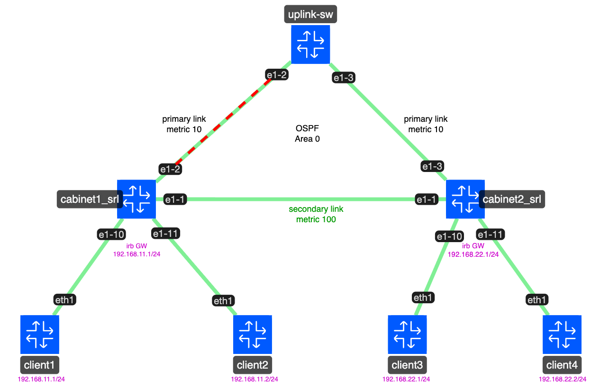
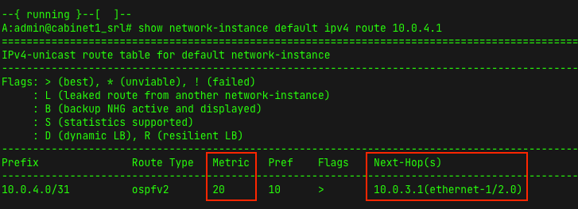
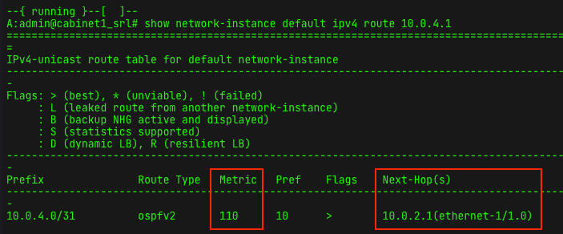
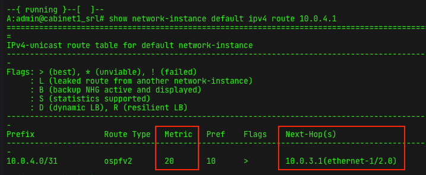

#Author: Mohammad Zaman (Github: @mfzhsn and @learn-nokia, LinkedIn: www.linkedin.com/in/mohammad-f-zaman)

# A1-Topo containerlab

This repository contains a containerlab topology for SR Linux lab built around Nokia SR Linux IXS-A1 nodes and a central uplink switch. It is intended for testing connectivity, failover, and recovery workflows in a simple, reproducible virtual environment.

## Topology overview



The lab consists of:

- 2 Nokia SR Linux IXS-A1 cabinets:
  - `cabinet1_srl`
  - `cabinet2_srl`
- 1 uplink switch:
  - `uplink-sw`
- 4 Linux clients:
  - `client1`
  - `client2`
  - `client3`
  - `client4`

Connectivity is arranged as follows:

- `client1` and `client2` connect to `cabinet1_srl`
- `client3` and `client4` connect to `cabinet2_srl`
- `cabinet1_srl` and `cabinet2_srl` are interconnected
- both cabinets connect to the uplink switch

The topology file is defined in `a1-topo.clab.yml` and the generated lab artifacts live under `clab-a1-topo/`.


## Deployment

Requirements:

- Docker
- containerlab installed on the host

Deploy the lab from the repository:

```bash
containerlab deploy -t a1-topo.clab.yml
```

To remove the lab:

```bash
containerlab destroy -t a1-topo.clab.yml --cleanup
```

## Demo

The repository includes screenshot-based evidence for the before, after, and recovery phases of the lab workflow.

Start Ping from `client1` to `e-1/3.0` interface at `uplink-sw`. Bring down the `e-1/2.0` interface at `uplink-sw` and observe the failover traffic towards `secondary-link` interface at `cabinet1_srl`. Finally, restore and observe the recovery of the ping traffic. Follow the topology diagram for the interface names and IP addresses.

### Pre-change state



### Post-change state

```
60      59.073953899    ethernet-1/2.0  1a:86:00:ff:00:02       1a:78:06:ff:00:02       192.168.11.10   10.0.4.1        ICMP    146     Echo (ping) request  id=0x000b, seq=83/21248, ttl=63
61      60.074972141    ethernet-1/2.0  1a:86:00:ff:00:02       1a:78:06:ff:00:02       192.168.11.10   10.0.4.1        ICMP    146     Echo (ping) request  id=0x000b, seq=84/21504, ttl=63
62      61.076033967    ethernet-1/2.0  1a:86:00:ff:00:02       1a:78:06:ff:00:02       192.168.11.10   10.0.4.1        ICMP    146     Echo (ping) request  id=0x000b, seq=85/21760, ttl=63
63      62.076959573    ethernet-1/2.0  1a:86:00:ff:00:02       1a:78:06:ff:00:02       192.168.11.10   10.0.4.1        ICMP    146     Echo (ping) request  id=0x000b, seq=86/22016, ttl=63
64      64.111962977    ethernet-1/3.0  1a:f0:01:ff:00:03       1a:78:06:ff:00:03       192.168.11.10   10.0.4.1        ICMP    146     Echo (ping) request  id=0x000b, seq=88/22528, ttl=62
65      65.104006037    ethernet-1/3.0  1a:f0:01:ff:00:03       1a:78:06:ff:00:03       192.168.11.10   10.0.4.1        ICMP    146     Echo (ping) request  id=0x000b, seq=89/22784, ttl=62
66      66.105991557    ethernet-1/3.0  1a:f0:01:ff:00:03       1a:78:06:ff:00:03       192.168.11.10   10.0.4.1        ICMP    146     Echo (ping) request  id=0x000b, seq=90/23040, ttl=62

```



### Recovery state



```
17      16.020006477    ethernet-1/3.0  1a:f0:01:ff:00:03       1a:78:06:ff:00:03       192.168.11.10   10.0.4.1        ICMP    146     Echo (ping) request  id=0x000b, seq=133/34048, ttl=62
18      17.021008435    ethernet-1/3.0  1a:f0:01:ff:00:03       1a:78:06:ff:00:03       192.168.11.10   10.0.4.1        ICMP    146     Echo (ping) request  id=0x000b, seq=134/34304, ttl=62
19      18.021963028    ethernet-1/2.0  1a:86:00:ff:00:02       1a:78:06:ff:00:02       192.168.11.10   10.0.4.1        ICMP    146     Echo (ping) request  id=0x000b, seq=135/34560, ttl=63
20      19.023014658    ethernet-1/2.0  1a:86:00:ff:00:02       1a:78:06:ff:00:02       192.168.11.10   10.0.4.1        ICMP    146     Echo (ping) request  id=0x000b, seq=136/34816, ttl=63

```